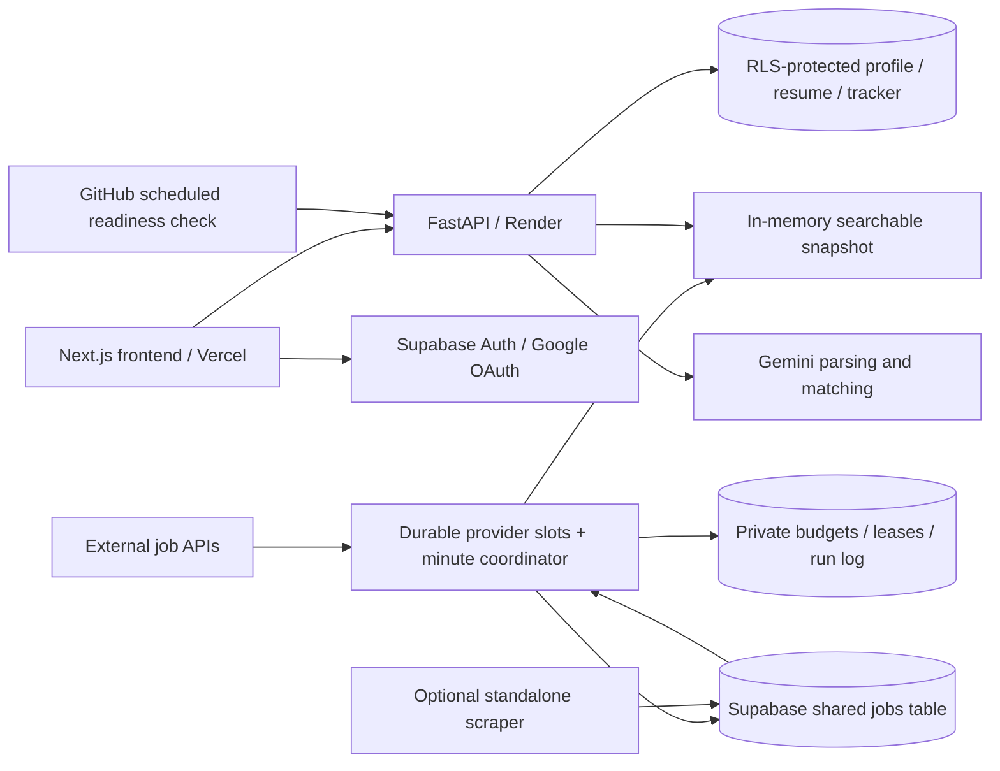

# Job Finder AI

A job-search application for remote technology opportunities and Pakistan listings, with PDF resume parsing, job matching, AI application assistance, and a personal application tracker.

[Live application](https://job-finder-ai-kappa.vercel.app/) · [Backend health](https://job-finder-ai-backend.onrender.com/api/health) · [Issues](https://github.com/KhuzaimaHassan/job-finder-ai/issues)

## What works

- Google sign-in through Supabase Auth; protected dashboard, profile, resume, and tracker pages.
- Search by keyword, location, source, work arrangement, and employment type. Remote and Full-time can be combined.
- Resume upload: text-based PDF, maximum 10 MiB, with structured Gemini parsing. Scanned PDFs require OCR outside this application.
- Matching: up to 100 keyword-shortlisted candidates ranked with embeddings, with a labelled keyword fallback if the AI provider fails or times out. Scores are relevance estimates.
- AI tools: resume/job compatibility estimate, cover letter, skill-gap analysis with reviewed learning resources, interview preparation, and resume suggestions.

All job AI tools use the uploaded resume; skills-gap and interview preparation
also include saved profile skills. Prompts receive the current UTC date to
interpret career dates, distinguish internships from employment, and avoid
inventing availability or credentials. Compatibility percentages are AI estimates
and are not scores from an employer's ATS. Review generated text before using it.
Learning links come from a reviewed publisher catalog; a workflow-specific gap
uses its matching resource rather than a tutorial for an incidental language.
Provider quota exhaustion is returned as HTTP 429 with an actionable message;
temporary outages and timeouts use 503/504. The app does not automatically change
plans or retry quota failures. The Gemini project's configured limits apply to
resume parsing and generation across all users.
- Tracker stages: Saved → Applied → Interview → Offer → Rejected. Desktop dragging, mobile status controls, and persistent notes are supported.
- Resume synchronization adds skills while preserving manually entered experience years and target roles. Replacement uploads retain previous saved versions.

## Are the jobs live and recent?

**The application polls live provider APIs and enforces source-date, last-observation, and expiry limits on every search/matching read.** By default a listing must be dated/updated within 30 days and last observed within 14 days. Unknown dates, explicit expiry/closure and checked-unknown availability are excluded. Source dates are not universally original publication dates.

The API checks durable per-provider budgets every minute. Provider refreshes use UTC six-hour slots, with one daily slot for Himalayas. A [GitHub scheduled workflow](.github/workflows/job-refresh.yml) wakes the service at four daily times and verifies readiness; database leases prevent duplicate runs and run records persist across restarts. Scheduling remains best effort, not an uptime SLA.

Records are archived from discovery, **not hard-deleted**. Both the cloud path and optional local scraper preserve saved-job history. Historical detail links disable Apply. This is a timestamp/status policy with durable run history, rather than destructive batch rotation.

Search supports word-aware terms/phrases, combined filters and last-7/14-day views in both All Jobs and Matched for Me. Personalized ranking uses skills, target roles, entered experience, known location restrictions and the latest resume, with visible match reasons and a consistent profile-based fallback.

### Current source coverage

| Source | Behavior |
| --- | --- |
| RemoteOK | One feed per due slot; technology-role filtering |
| Remotive | One broad feed per due slot; filtered locally, avoiding overlapping burst queries |
| Himalayas | Five newest-first searches with bounded sequential pages; expiry/identity/restrictions persisted |
| Jobicy | Canonical cursor feed plus stored-job availability checks |
| Adzuna | Optional credentialed GB/US/India searches, date ordering and bounded pages |
| Indeed / LinkedIn | Separate optional manual scraper; no provisioned automatic Pakistan importer |
| JSearch | Disabled pending an operating-budget decision |

Page budgets intentionally bound discovery; coverage caps and provider failures are reported rather than treated as a complete catalogue. Remote jobs can have country/timezone restrictions. Employer availability remains subject to change.

See [job fetching, search, matching and operations](docs/JOB_FETCHING.md). The [28 October production audit](docs/job-freshness-audit-2026-10-28.json) documents the **previous** implementation and is retained as historical evidence.

## Architecture and repository



| Area | Implementation |
| --- | --- |
| Frontend | Next.js 16.2, React 19.2, TypeScript, Tailwind CSS 4 |
| Backend | Python 3.12 on Render, FastAPI, Pydantic, APScheduler |
| Persistence | Supabase Postgres, Auth, private PDF storage |
| AI | Configurable Gemini chat model and embedding model |
| Deployment | GitHub `main` → Vercel frontend and Render backend |

```text
backend/app/main.py                  API startup, CORS, scheduler, health
backend/app/routers/                  Jobs, auth, profile, resume, AI, tracker
backend/app/services/job_fetcher.py   Snapshot, persistence, search
backend/app/services/job_sources.py   Bounded provider adapters
backend/app/services/ingestion.py     Durable leases, provider budgets and run history
backend/app/services/job_policy.py    Shared freshness/search/eligibility rules
backend/app/services/embeddings.py    Bounded semantic ranking and fallback
backend/scripts/audit_freshness.py    Read-only live freshness audit
backend/scripts/scrape_and_upload.py  Optional manual scraper; preserves history
backend/tests/                       Regression tests and disposable browser fixture
frontend/src/app/                    Dashboard, job, profile, resume, tracker, login
frontend/src/components/             Navigation, job cards, filters, AI dialogs
frontend/src/contexts/               Auth initialization and user isolation
supabase_setup.sql                   Tables, RLS, private PDF bucket/policies
render.yaml                          Backend deployment configuration
docs/JOB_FETCHING.md                  Ingestion behavior and operational guidance
VERIFICATION.md                      Release validation and test limits
```

## Local setup

Use **Python 3.12** to match the deployed backend and **Node.js 20.9+** (Node 22 recommended). Optional providers and AI calls may require accounts or incur provider usage; no provider pricing allowance is guaranteed here.

### 1. Supabase and Google sign-in

1. For an existing installation apply [`backend/migrations/20261028_ingestion.sql`](backend/migrations/20261028_ingestion.sql) before this release. For a new installation create or select a Supabase project. Review and run [`supabase_setup.sql`](supabase_setup.sql) in its SQL editor. It creates `jobs`, `profiles`, `resumes`, `applications`, RLS policies, the signup profile trigger, and a private `resumes` PDF bucket with user-folder policies. Review policy changes before rerunning it on an existing project.
2. Enable Google in Supabase Authentication and configure the Google OAuth client for your Supabase callback URL.
3. Set the Supabase Site URL to your frontend URL and allow `http://localhost:3000/dashboard` for local OAuth redirects. Allow `https://job-finder-ai-kappa.vercel.app/dashboard` for this production frontend, or the equivalent URL for your own deployment.
4. Keep the Supabase service-role key on the backend only. The browser uses the public anon key and the signed-in user's token. Jobs are publicly readable; user tables and resume objects use user policies.

### 2. Backend

From the repository root:

```bash
cd backend
python -m venv venv
# macOS / Linux
source venv/bin/activate
# Windows PowerShell instead: .\venv\Scripts\Activate.ps1
pip install -r requirements.txt
cp .env.example .env
# PowerShell instead of cp: Copy-Item .env.example .env
```

Set actual values in `backend/.env`, then run:

```bash
uvicorn app.main:app --reload --host 127.0.0.1 --port 8000
```

Local API docs: [localhost:8000/docs](http://localhost:8000/docs). OpenAPI/Swagger are disabled when `RENDER` is set or `ENVIRONMENT=production`.

### 3. Frontend

In another terminal, from the repository root:

```bash
cd frontend
npm ci
cp .env.local.example .env.local
# PowerShell instead of cp: Copy-Item .env.local.example .env.local
npm run dev
```

Set the frontend environment values before starting. Open [localhost:3000](http://localhost:3000).

### Configuration

| Variable | Where | Meaning / default |
| --- | --- | --- |
| `SUPABASE_URL` | Backend | Supabase project URL |
| `SUPABASE_KEY` | Backend | Public anon key used with each user's JWT |
| `SUPABASE_SERVICE_KEY` | Backend only | Administrative reads and job-cache writes; never expose as `NEXT_PUBLIC_*` |
| `GEMINI_API_KEY` | Backend only | Enables resume parsing and AI tools; matching falls back to keywords without it |
| `GEMINI_AI_MODEL` | Backend | `gemini-2.5-flash` default |
| `GEMINI_EMBEDDING_MODEL` | Backend | `gemini-embedding-001` default |
| `MATCH_CANDIDATE_LIMIT` | Backend | Semantic shortlist, default 100, maximum 100 |
| `MATCH_TIMEOUT_SECONDS` | Backend | Semantic ranking deadline, default 20, maximum 40 |
| `JOB_CACHE_MAX_AGE_DAYS` | Backend | Maximum last-observation age, default 14; also enforced at read time |
| `JOB_POSTED_MAX_AGE_DAYS` | Backend | Source publication/update age cap, default 30 |
| `JOB_PROVIDER_MAX_PAGES` | Backend | Sequential traversal budget per query, default 5 |
| `JOB_REFRESH_TIMEOUT_SECONDS` | Backend | Whole-run deadline, default 240 seconds |
| `FRONTEND_URL` | Backend | Allowed frontend origin for CORS |
| `ADZUNA_APP_ID`, `ADZUNA_APP_KEY` | Backend | Optional Adzuna credentials |
| `JSEARCH_API_KEY` | Backend | Unused by the scheduled aggregator while its calls remain disabled |
| `NEXT_PUBLIC_API_URL` | Frontend | `http://localhost:8000` locally; Render API origin in production |
| `NEXT_PUBLIC_SUPABASE_URL` | Frontend | Same Supabase project as the backend |
| `NEXT_PUBLIC_SUPABASE_ANON_KEY` | Frontend | Public anon key; never the service-role key |

The coordinator ticks once per minute, while durable UTC source slots limit actual provider requests. See the fetching guide for schedule and coverage limits. `NEXT_PUBLIC_*` values are embedded at build time, so changing them requires a frontend rebuild.

## API reference

The frontend attaches the current Supabase bearer token to authenticated requests.

| Route | Access | Purpose |
| --- | --- | --- |
| `GET /api/health` | Public | Liveness, readiness, cached count and deployment revision |
| `GET /api/ready` | Public | 200/503 readiness and ingestion state |
| `GET /api/jobs/status` | Public | Sanitized provider outcomes, times and coverage limits |
| `GET /api/jobs` | Public | Search; `q`, `location`, `job_type`, `employment_type`, `source`, `posted_within_days`, `page`, `per_page` (1–100) |
| `GET /api/jobs/search` | Public | Alias that uses `type` for work arrangement instead of `job_type` |
| `GET /api/jobs/stats` | Public | Current snapshot counts by source |
| `GET /api/jobs/{id}` | Public | Active detail or retained archived record |
| `GET /api/jobs/matched` | Bearer token | Personalized ranking; optional `page`, `per_page` (1–50) |
| `GET /api/auth/me` | Bearer token | Current authenticated user |
| `GET/PATCH /api/profile` | Bearer token | Read or update profile |
| `POST /api/profile/sync-from-resume` | Bearer token | Merge latest resume skills into profile |
| `GET /api/resume`, `POST /api/resume/upload` | Bearer token | Read latest parsed resume / multipart PDF upload |
| `GET/POST /api/applications` | Bearer token | Read / save applications |
| `PATCH/DELETE /api/applications/{id}` | Bearer token | Edit status/notes or remove an application |
| `POST /api/ai/{tool}` | Bearer token | `ats-score`, `cover-letter`, `skill-gap`, `interview-prep`, `resume-improve` |

Example: `GET /api/jobs?q=python&job_type=remote&employment_type=fulltime&page=1&per_page=20`. All Jobs queries match descriptions as well as titles. There is no privileged public “fetch now” endpoint. Source-date filters and sanitized run/source status are available.

## Verification

Backend regression suite (from `backend/`):

```bash
python -m unittest discover -s tests -p 'test_*.py' -v
```

Frontend (from `frontend/`, with your intended environment configured):

```bash
npm run lint
npm run build
```

See [VERIFICATION.md](VERIFICATION.md) for tested flows and limits. The live freshness audit is read-only:

```bash
cd backend
python scripts/audit_freshness.py
# Optional: also read the PUBLIC jobs table configured in backend/.env
python scripts/audit_freshness.py --database --output ../freshness-report.json
```

When using `--database`, confirm that the configured Supabase project belongs to the API being audited. The report contains aggregate public job data, scans up to 50,000 DB rows, and marks that limit if reached. It does not invoke the scheduler, scrape providers, change rows, or prove recurring execution from one sample. API pagination is not transactionally consistent if a refresh occurs mid-audit.

### Disposable local browser fixture

The fixture exercises the real API routers and PDF extraction with in-memory database/storage, simulated auth, and deterministic AI. It never writes to production. **Never deploy it.**

Terminal 1, from `backend/`:

```bash
python -m uvicorn tests.browser_app:app --host 127.0.0.1 --port 8000
```

Terminal 2, from `frontend/`, set these process variables before building:

```text
NEXT_PUBLIC_API_URL=http://localhost:8000
NEXT_PUBLIC_SUPABASE_URL=http://localhost:8000
NEXT_PUBLIC_SUPABASE_ANON_KEY=local-disposable-anon
```

Then run `npm run build` and `npm start`. On [localhost:3000](http://localhost:3000), Continue with Google uses the disposable provider. A synthetic PDF is available at `http://localhost:8000/_test/resume.pdf`. Restarting the fixture discards its data. Rebuild with real environment values before using the frontend with real services.

## Deployment and operations

This repository's existing integrations deploy changes merged to `main`:

- **Vercel:** root directory `frontend`; configure the three `NEXT_PUBLIC_*` variables.
- **Render:** root directory `backend`; `pip install -r requirements.txt`; production entrypoint `uvicorn app.main:app --host 0.0.0.0 --port $PORT`. Configure backend secrets and `FRONTEND_URL`. See [render.yaml](render.yaml).
- **Release check:** compare the frontend `X-App-Revision` header and backend `/api/health` JSON `revision` with the GitHub main commit. Neither marker confirms ingestion health.
- **Scheduler:** the minute coordinator reads durable source budgets and leases. The GitHub scheduled readiness check wakes a sleeping web service at 00:23/06:23/12:23/18:23 UTC. Delayed Actions/service outages remain possible; inspect database run records and public status.
- **Manual scraper:** a separate optional importer, with no recurring Pakistan runner configured. Old records are retained and the API applies its shared freshness policy.

## Known limitations and next work

The release enforces freshness, expiry and history preservation, records durable runs and source budgets, and verifies search/matching behavior. Discovery is still bounded and source availability is external; full catalogue traversal, complete geocoding/eligibility, an exact schedule SLA, and a sustainable automatic Pakistan feed remain outside this implementation. The current Gemini chat SDK also needs migration. See [JOB_FETCHING.md](docs/JOB_FETCHING.md) and [VERIFICATION.md](VERIFICATION.md) for current behavior and validation limits.

No license file is currently included in the repository; this README does not grant or invent a license.
