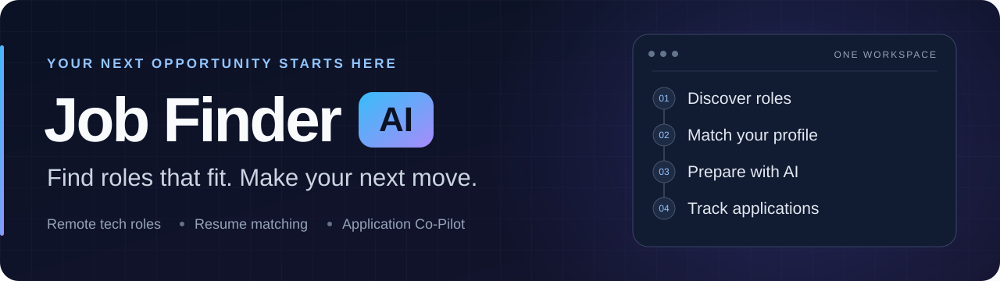

  

  <strong>Job discovery, resume matching, and application preparation in one workspace.</strong>

  <a href="https://ai-jobfinder.vercel.app/"><strong>Open the app →</strong></a>
  &nbsp; · &nbsp;
  <a href="docs/SETUP.md">Run locally</a>
  &nbsp; · &nbsp;
  <a href="docs/FEATURES.md">Explore features</a>

## About the project

Job Finder AI brings the main parts of a job search together: discovering opportunities, understanding how they fit your experience, preparing application material, and tracking your progress.

It focuses on **remote technology roles and Pakistan listings**, using your saved profile and uploaded resume to make the search more personal. You choose the opportunities to pursue and review the AI-generated material before using it.

## What you can do

| | Capability | What it helps you do |
| --- | --- | --- |
| 🔎 | **Discover opportunities** | Search by keyword, location, source, work arrangement, and employment type. |
| 🧩 | **Understand your fit** | Find matches based on your skills, target roles, experience, location, and resume—with visible match reasons. |
| 📄 | **Bring your resume** | Upload a PDF, extract structured skills and experience, and store the original privately. |
| ✨ | **Prepare with Co-Pilot** | Review compatibility estimates, draft cover letters, explore skill gaps, and practice interview questions. |
| 🗂️ | **Keep track of progress** | Organize opportunities from Saved through Applied, Interview, Offer, or Rejected, with notes. |

Read the [feature guide](docs/FEATURES.md) for the full behavior and limitations.

## From discovery to your next application

1. **Set up your profile** — add your skills, target roles, experience, and location.
2. **Upload your resume** — make your actual experience available to matching and AI tools.
3. **Explore and compare** — search the catalogue or use **Matched for Me** to review relevant roles.
4. **Prepare your application** — open a job's Co-Pilot tools and review the generated suggestions.
5. **Track what happens next** — save the role, update its stage, and keep your notes together.

## Built with

| Layer | Technologies |
| --- | --- |
| **Interface** | Next.js · React · TypeScript · Tailwind CSS |
| **Backend** | Python · FastAPI · APScheduler |
| **Data & identity** | Supabase Postgres · Google sign-in · private PDF storage |
| **AI** | Gemini parsing and generation · semantic embeddings |
| **Hosting** | Vercel frontend · Render backend |

See the [architecture guide](docs/ARCHITECTURE.md) for the system diagram and repository layout.

## Explore the documentation

The detailed guides live under `docs/`. Each link below opens its Markdown file directly.

| Guide | What's inside |
| --- | --- |
| [Features](docs/FEATURES.md) | Product capabilities, AI behavior, and known limitations |
| [Architecture](docs/ARCHITECTURE.md) | System diagram, technology stack, and repository structure |
| [Local setup](docs/SETUP.md) | Supabase, Google sign-in, backend, and frontend setup |
| [Configuration](docs/CONFIGURATION.md) | Environment variables and defaults |
| [API reference](docs/API.md) | Endpoints, authentication, filters, and examples |
| [Job fetching & matching](docs/JOB_FETCHING.md) | Providers, freshness, pagination, search, and ranking |
| [Deployment](docs/DEPLOYMENT.md) | Vercel, Render, release checks, and scheduling |
| [Testing](docs/TESTING.md) | Regression commands, audits, and the disposable browser fixture |
| [Operations](docs/OPERATIONS.md) | Readiness checks, free-tier limits, and open incidents |
| [Verification history](docs/VERIFICATION.md) | Dated checks, release evidence, and reliability findings |

## Project status

Ongoing work includes backend memory reliability on the free Render instance. The [operations guide](docs/OPERATIONS.md) records the open findings, and the [verification history](docs/VERIFICATION.md) separates completed checks from remaining work.

---

No license file is currently included in the repository. This README does not grant a license.
