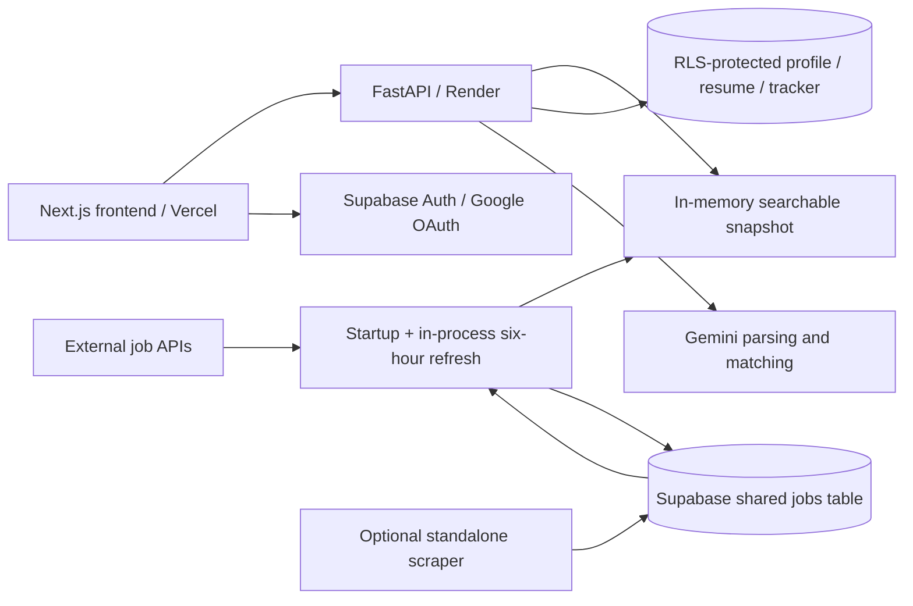

# Job Finder AI

A job-search application for remote technology opportunities and Pakistan listings, with PDF resume parsing, job matching, AI application assistance, and a personal application tracker.

[Live application](https://job-finder-ai-kappa.vercel.app/) · [Backend health](https://job-finder-ai-backend.onrender.com/api/health) · [Issues](https://github.com/KhuzaimaHassan/job-finder-ai/issues)

## What works

- Google sign-in through Supabase Auth; protected dashboard, profile, resume, and tracker pages.
- Search by keyword, location, source, work arrangement, and employment type. Remote and Full-time can be combined.
- Resume upload: text-based PDF, maximum 10 MiB, with structured Gemini parsing. Scanned PDFs require OCR outside this application.
- Matching: up to 100 keyword-shortlisted candidates ranked with embeddings, with a labelled keyword fallback if the AI provider fails or times out. Scores are relevance estimates.
- AI tools: resume/job compatibility estimate, cover letter, skill-gap analysis with reviewed learning resources, interview preparation, and resume suggestions.
- Tracker stages: Saved → Applied → Interview → Offer → Rejected. Desktop dragging, mobile status controls, and persistent notes are supported.
- Resume synchronization adds skills while preserving manually entered experience years and target roles. Replacement uploads retain previous saved versions.

## Are the jobs live and recent?

**The application polls live provider APIs; it is not a real-time feed or an employer-availability guarantee.** Fetching starts when the backend starts and is scheduled every six hours while that process stays running. User searches read an in-memory snapshot instead of calling providers on each request.

The backend reloads database jobs seen within `JOB_CACHE_MAX_AGE_DAYS` (default **14 days**), merges newly fetched results, and replaces the searchable snapshot. `fetched_at` means **last observed by an importer**; `posted_date` comes from the source and can be much older. Repeatedly returned jobs renew their last-seen timestamp, so the 14-day rule does not mean “posted in the last 14 days.”

Old rows are normally **excluded from search, not deleted from Supabase**. Historical job links can return an archived page with Apply disabled. There are no persisted batch records or automatic batch rotation. The optional standalone scraper currently has a separate hard-delete cleanup and should not be used unchanged when historical links must be preserved.

See [job fetching, freshness, limitations, and improvement priorities](docs/JOB_FETCHING.md), including the [dated production audit](docs/job-freshness-audit-2026-10-28.json). Those counts are a snapshot, not a live dashboard.

### Current source coverage

| Source | Scheduled cloud behavior | Coverage and requirements |
| --- | --- | --- |
| RemoteOK | One API request per refresh | Public feed, filtered by broad technology keywords |
| Remotive | 15 category/search requests per refresh | Public API; overlapping requests; needs consolidation and rate control |
| Himalayas | Five searches, first page, at most 20 per search | Public API; no full traversal or explicit newest-first sort |
| Jobicy | Four requests, at most 50 per request | Existing `/api/v2/remote-jobs` adapter; no cursor traversal or stored-job status checks |
| Adzuna | Three first-page queries, GB/US/India, up to 50 each | Requires `ADZUNA_APP_ID` and `ADZUNA_APP_KEY`; no Pakistan API query |
| Indeed / Google via JobSpy helper | Only attempted if optional `python-jobspy` is installed | Package is absent from production requirements; no scheduled Pakistan coverage in the standard deployment |
| Indeed / LinkedIn standalone scraper | Separate manual process | `backend/scripts/scrape_and_upload.py`; no recurring runner is provisioned |
| JSearch | Disabled in the aggregator | Setting a key alone does not re-enable it; provider budget must be reviewed first |

“Remote” may still mean restricted to a country or timezone. The current application does not establish that every remote result accepts applicants in Pakistan. Keyword filtering can also include adjacent or unrelated roles.

## Architecture and repository



| Area | Implementation |
| --- | --- |
| Frontend | Next.js 16.2, React 19.2, TypeScript, Tailwind CSS 4 |
| Backend | Python 3.12 on Render, FastAPI, Pydantic, APScheduler |
| Persistence | Supabase Postgres, Auth, private PDF storage |
| AI | Configurable Gemini chat model and embedding model |
| Deployment | GitHub `main` → Vercel frontend and Render backend |

```text
backend/app/main.py                  API startup, CORS, scheduler, health
backend/app/routers/                  Jobs, auth, profile, resume, AI, tracker
backend/app/services/job_fetcher.py   Provider adapters, persistence, snapshot
backend/app/services/embeddings.py    Bounded semantic ranking and fallback
backend/scripts/audit_freshness.py    Read-only live freshness audit
backend/scripts/scrape_and_upload.py  Optional manual scraper; see cleanup caveat
backend/tests/                       Regression tests and disposable browser fixture
frontend/src/app/                    Dashboard, job, profile, resume, tracker, login
frontend/src/components/             Navigation, job cards, filters, AI dialogs
frontend/src/contexts/               Auth initialization and user isolation
supabase_setup.sql                   Tables, RLS, private PDF bucket/policies
render.yaml                          Backend deployment configuration
docs/JOB_FETCHING.md                  Ingestion behavior and operational guidance
VERIFICATION.md                      Release validation and test limits
```

## Local setup

Use **Python 3.12** to match the deployed backend and **Node.js 20.9+** (Node 22 recommended). Optional providers and AI calls may require accounts or incur provider usage; no provider pricing allowance is guaranteed here.

### 1. Supabase and Google sign-in

1. Create or select a Supabase project. Review and run [`supabase_setup.sql`](supabase_setup.sql) in its SQL editor. It creates `jobs`, `profiles`, `resumes`, `applications`, RLS policies, the signup profile trigger, and a private `resumes` PDF bucket with user-folder policies. Review policy changes before rerunning it on an existing project.
2. Enable Google in Supabase Authentication and configure the Google OAuth client for your Supabase callback URL.
3. Set the Supabase Site URL to your frontend URL and allow `http://localhost:3000/dashboard` for local OAuth redirects. Allow `https://job-finder-ai-kappa.vercel.app/dashboard` for this production frontend, or the equivalent URL for your own deployment.
4. Keep the Supabase service-role key on the backend only. The browser uses the public anon key and the signed-in user's token. Jobs are publicly readable; user tables and resume objects use user policies.

### 2. Backend

From the repository root:

```bash
cd backend
python -m venv venv
# macOS / Linux
source venv/bin/activate
# Windows PowerShell instead: .\venv\Scripts\Activate.ps1
pip install -r requirements.txt
cp .env.example .env
# PowerShell instead of cp: Copy-Item .env.example .env
```

Set actual values in `backend/.env`, then run:

```bash
uvicorn app.main:app --reload --host 127.0.0.1 --port 8000
```

Local API docs: [localhost:8000/docs](http://localhost:8000/docs). OpenAPI/Swagger are disabled when `RENDER` is set or `ENVIRONMENT=production`.

### 3. Frontend

In another terminal, from the repository root:

```bash
cd frontend
npm ci
cp .env.local.example .env.local
# PowerShell instead of cp: Copy-Item .env.local.example .env.local
npm run dev
```

Set the frontend environment values before starting. Open [localhost:3000](http://localhost:3000).

### Configuration

| Variable | Where | Meaning / default |
| --- | --- | --- |
| `SUPABASE_URL` | Backend | Supabase project URL |
| `SUPABASE_KEY` | Backend | Public anon key used with each user's JWT |
| `SUPABASE_SERVICE_KEY` | Backend only | Administrative reads and job-cache writes; never expose as `NEXT_PUBLIC_*` |
| `GEMINI_API_KEY` | Backend only | Enables resume parsing and AI tools; matching falls back to keywords without it |
| `GEMINI_AI_MODEL` | Backend | `gemini-2.5-flash` default |
| `GEMINI_EMBEDDING_MODEL` | Backend | `gemini-embedding-001` default |
| `MATCH_CANDIDATE_LIMIT` | Backend | Semantic shortlist, default 100, maximum 100 |
| `MATCH_TIMEOUT_SECONDS` | Backend | Semantic ranking deadline, default 20, maximum 40 |
| `JOB_CACHE_MAX_AGE_DAYS` | Backend | Last-seen database loading window, default 14; not a publication-age filter |
| `FRONTEND_URL` | Backend | Allowed frontend origin for CORS |
| `ADZUNA_APP_ID`, `ADZUNA_APP_KEY` | Backend | Optional Adzuna credentials |
| `JSEARCH_API_KEY` | Backend | Unused by the scheduled aggregator while its calls remain disabled |
| `NEXT_PUBLIC_API_URL` | Frontend | `http://localhost:8000` locally; Render API origin in production |
| `NEXT_PUBLIC_SUPABASE_URL` | Frontend | Same Supabase project as the backend |
| `NEXT_PUBLIC_SUPABASE_ANON_KEY` | Frontend | Public anon key; never the service-role key |

Refresh frequency is currently hard-coded to six hours in `backend/app/main.py`; it is not an environment setting. `NEXT_PUBLIC_*` values are embedded at build time, so changing them requires a frontend rebuild.

## API reference

The frontend attaches the current Supabase bearer token to authenticated requests.

| Route | Access | Purpose |
| --- | --- | --- |
| `GET /api/health` | Public | Process health, cached count, deployment revision; does not prove a recent successful refresh |
| `GET /api/jobs` | Public | Search; `q`, `location`, `job_type`, `employment_type`, `source`, `page`, `per_page` (1–100) |
| `GET /api/jobs/search` | Public | Alias that uses `type` for work arrangement instead of `job_type` |
| `GET /api/jobs/stats` | Public | Current snapshot counts by source |
| `GET /api/jobs/{id}` | Public | Active detail or retained archived record |
| `GET /api/jobs/matched` | Bearer token | Personalized ranking; optional `page`, `per_page` (1–50) |
| `GET /api/auth/me` | Bearer token | Current authenticated user |
| `GET/PATCH /api/profile` | Bearer token | Read or update profile |
| `POST /api/profile/sync-from-resume` | Bearer token | Merge latest resume skills into profile |
| `GET /api/resume`, `POST /api/resume/upload` | Bearer token | Read latest parsed resume / multipart PDF upload |
| `GET/POST /api/applications` | Bearer token | Read / save applications |
| `PATCH/DELETE /api/applications/{id}` | Bearer token | Edit status/notes or remove an application |
| `POST /api/ai/{tool}` | Bearer token | `ats-score`, `cover-letter`, `skill-gap`, `interview-prep`, `resume-improve` |

Example: `GET /api/jobs?q=python&job_type=remote&employment_type=fulltime&page=1&per_page=20`. All Jobs queries match descriptions as well as titles. There is no public “fetch now” endpoint, publication-date filter, or ingestion-run dashboard.

## Verification

Backend regression suite (from `backend/`):

```bash
python -m unittest discover -s tests -p 'test_*.py' -v
```

Frontend (from `frontend/`, with your intended environment configured):

```bash
npm run lint
npm run build
```

See [VERIFICATION.md](VERIFICATION.md) for tested flows and limits. The live freshness audit is read-only:

```bash
cd backend
python scripts/audit_freshness.py
# Optional: also read the PUBLIC jobs table configured in backend/.env
python scripts/audit_freshness.py --database --output ../freshness-report.json
```

When using `--database`, confirm that the configured Supabase project belongs to the API being audited. The report contains aggregate public job data, scans up to 50,000 DB rows, and marks that limit if reached. It does not invoke the scheduler, scrape providers, change rows, or prove recurring execution from one sample. API pagination is not transactionally consistent if a refresh occurs mid-audit.

### Disposable local browser fixture

The fixture exercises the real API routers and PDF extraction with in-memory database/storage, simulated auth, and deterministic AI. It never writes to production. **Never deploy it.**

Terminal 1, from `backend/`:

```bash
python -m uvicorn tests.browser_app:app --host 127.0.0.1 --port 8000
```

Terminal 2, from `frontend/`, set these process variables before building:

```text
NEXT_PUBLIC_API_URL=http://localhost:8000
NEXT_PUBLIC_SUPABASE_URL=http://localhost:8000
NEXT_PUBLIC_SUPABASE_ANON_KEY=local-disposable-anon
```

Then run `npm run build` and `npm start`. On [localhost:3000](http://localhost:3000), Continue with Google uses the disposable provider. A synthetic PDF is available at `http://localhost:8000/_test/resume.pdf`. Restarting the fixture discards its data. Rebuild with real environment values before using the frontend with real services.

## Deployment and operations

This repository's existing integrations deploy changes merged to `main`:

- **Vercel:** root directory `frontend`; configure the three `NEXT_PUBLIC_*` variables.
- **Render:** root directory `backend`; `pip install -r requirements.txt`; production entrypoint `uvicorn app.main:app --host 0.0.0.0 --port $PORT`. Configure backend secrets and `FRONTEND_URL`. See [render.yaml](render.yaml).
- **Release check:** compare the frontend `X-App-Revision` header and backend `/api/health` JSON `revision` with the GitHub main commit. Neither marker confirms ingestion health.
- **Scheduler:** runs inside the API process; use one worker/instance with this design. Multiple workers start independent schedulers and caches. A web-service restart starts a new fetch and resets the interval. If your Render instance can sleep, unattended six-hour execution is not assured. See [operational guidance and provider references](docs/JOB_FETCHING.md#operations-and-troubleshooting).
- **Manual scraper:** no recurring runner is provisioned. Read the [cleanup caveat](docs/JOB_FETCHING.md#optional-local-scraper) before using it; its existing cleanup can delete archived job records.

## Known limitations and next work

The fetching approach is suitable as an MVP foundation, but does not yet provide strict freshness, complete discovery, or a durable ingestion service. Priorities are a durable scheduler/run log, provider-specific rate budgets, explicit expiry/closure validation, cursor/page coverage, and one archive/retention policy shared by every importer. The current Gemini chat SDK is also deprecated and needs migration. Detailed acceptance criteria are in [JOB_FETCHING.md](docs/JOB_FETCHING.md#prioritized-improvements).

No license file is currently included in the repository; this README does not grant or invent a license.
