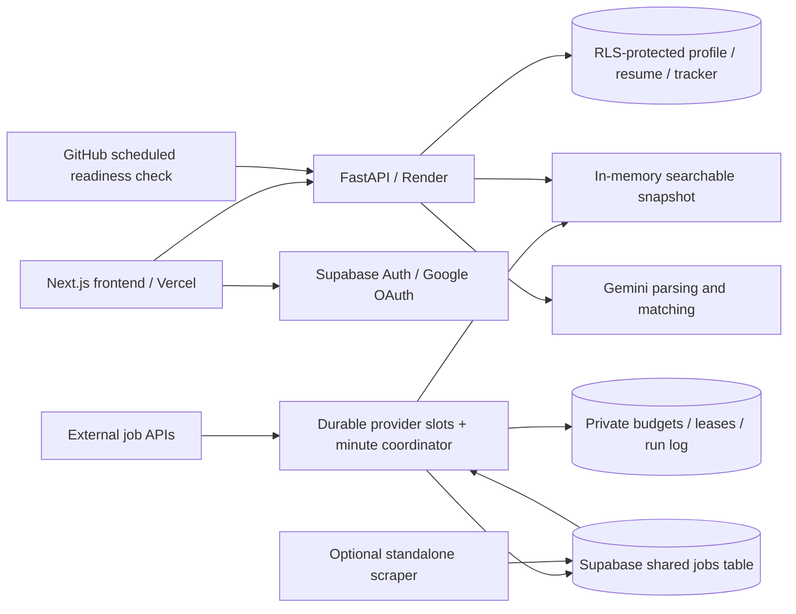

# Architecture and repository

[Back to documentation](../README.md)



| Area | Implementation |
| --- | --- |
| Frontend | Next.js 16.2, React 19.2, TypeScript, Tailwind CSS 4 |
| Backend | Python 3.12 on Render, FastAPI, Pydantic, APScheduler |
| Persistence | Supabase Postgres, Auth, private PDF storage |
| AI | Configurable Gemini chat model and embedding model |
| Deployment | GitHub `main` → Vercel frontend and Render backend |

```text
backend/app/main.py                  API startup, CORS, scheduler, health
backend/app/routers/                  Jobs, auth, profile, resume, AI, tracker
backend/app/services/job_fetcher.py   Snapshot, persistence, search
backend/app/services/job_sources.py   Bounded provider adapters
backend/app/services/ingestion.py     Durable leases, provider budgets and run history
backend/app/services/job_policy.py    Shared freshness/search/eligibility rules
backend/app/services/embeddings.py    Bounded semantic ranking and fallback
backend/scripts/audit_freshness.py    Read-only live freshness audit
backend/scripts/scrape_and_upload.py  Optional manual scraper; preserves history
backend/tests/                       Regression tests and disposable browser fixture
frontend/src/app/                    Dashboard, job, profile, resume, tracker, login
frontend/src/components/             Navigation, job cards, filters, AI dialogs
frontend/src/contexts/               Auth initialization and user isolation
supabase_setup.sql                   Tables, RLS, private PDF bucket/policies
render.yaml                          Backend deployment configuration
docs/                                Features, architecture, setup, API, deployment and testing
docs/JOB_FETCHING.md                  Ingestion behavior and operational guidance
docs/OPERATIONS.md                    Service checks, free-tier limits and open incidents
docs/VERIFICATION.md                 Release validation and test limits
VERIFICATION.md                      Compatibility link to the verification record
```
